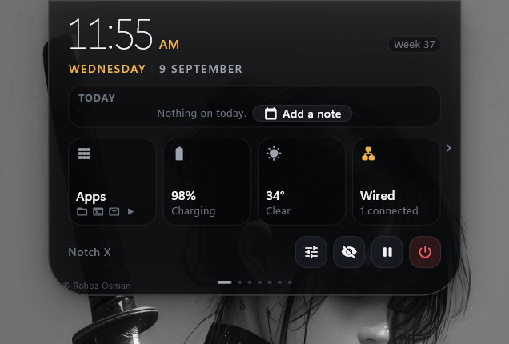
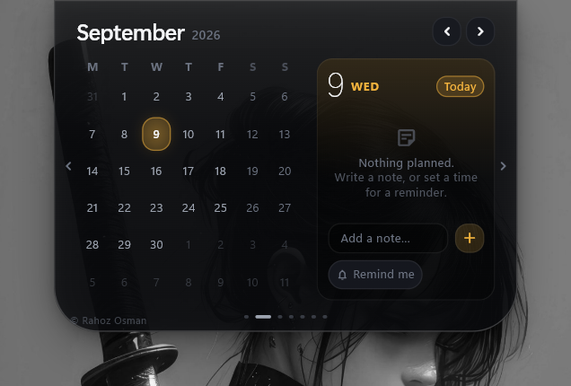
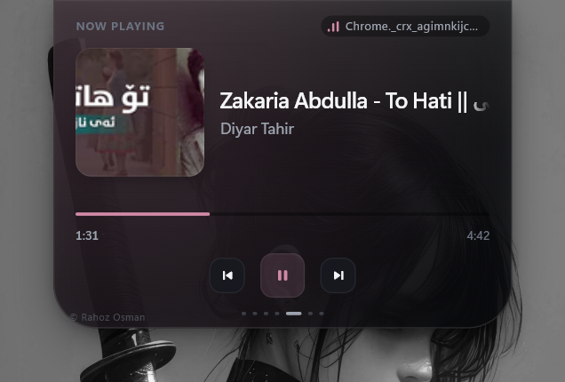
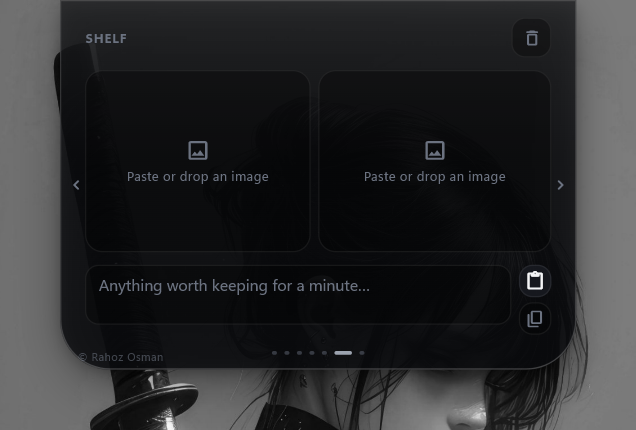
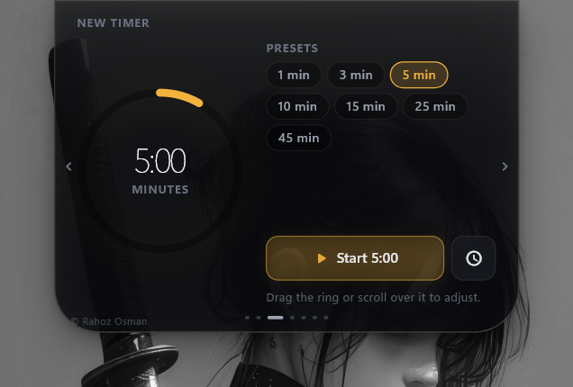
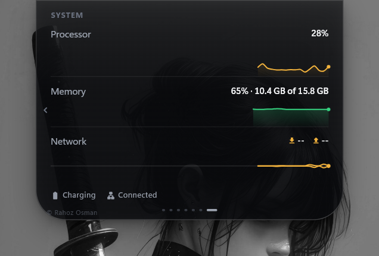

<div align="center">

# DynamicBar

**A Dynamic Island for Windows 11.**

A single shape at the top of your screen that stays out of the way, knows what
your machine is doing, and opens into the seven things you actually reach for.

[](#requirements)
[](https://flutter.dev)
[](https://dart.dev)
[](docs/WINDOWS_INTEGRATION.md)
[](#design-notes)
[](#privacy)

</div>

---

## What it is

Apple's Dynamic Island works because it is *one shape that morphs*, not a panel
that appears. DynamicBar takes that idea seriously on Windows: a transparent,
click-through overlay hangs from the top edge of your monitor, withdraws into
the bezel when you are working elsewhere, and comes back in about a tenth of a
second when your pointer approaches. Open it and it becomes a workspace — the
day's notes, your shortcuts, what is playing, a scratch shelf, timers, and live
graphs of the machine.

Every capability comes from a Win32 or WinRT API wrapped by hand in one C++
library. There are **no runtime package dependencies** and the application makes
**no network requests at all**.

## Screenshots

<table>
  <tr>
    <td width="50%"></td>
    <td width="50%"></td>
  </tr>
  <tr>
    <td><b>Now</b> &mdash; the time, the ISO week, what is on today, and the four tiles you glance at without opening anything.</td>
    <td><b>Calendar</b> &mdash; a month grid and a day panel. Write a note on any day; give it a time and it becomes a reminder.</td>
  </tr>
  <tr>
    <td></td>
    <td></td>
  </tr>
  <tr>
    <td><b>Media</b> &mdash; art, title, artist, timeline and transport, read from the same session API the Windows media flyout uses.</td>
    <td><b>Shelf</b> &mdash; two image slots and a note. Paste an image, or drag one onto the island and it lands in the next free slot.</td>
  </tr>
  <tr>
    <td></td>
    <td></td>
  </tr>
  <tr>
    <td><b>Timers</b> &mdash; presets, and a ring you drag or scroll to set. Countdowns are computed from the wall clock, so they never drift.</td>
    <td><b>System</b> &mdash; rolling one-minute graphs for processor, memory and network, with battery and connection underneath.</td>
  </tr>
</table>

## Features

| Module | Source | What it does |
|---|---|---|
| **Clock** | Local | The time, the date, the ISO week, and what is on today — assembled from your own notes and running timers, never from anything invented. |
| **Calendar** | Local | A month grid and a day panel. Write a note on any day; give it a time and it becomes a reminder. |
| **Shortcuts** | `ShellExecuteW` | Forty-odd pinnable targets — web addresses, known folders, applications and `ms-settings:` panels — plus mute, quiet and auto-hide toggles. |
| **Media** | `GlobalSystemMediaTransportControlsSessionManager` | Title, artist, album art, timeline and transport. The same API the Windows media flyout uses. |
| **Shelf** | Clipboard, OLE drag-and-drop, WIC | Two image slots and a note. Paste an image, or drag one onto the island and it lands in the next free slot. |
| **Timers** | Local | Countdowns and stopwatches, computed from the wall clock so they never drift. |
| **System** | Power, audio, capability and network APIs | Rolling one-minute graphs for processor, memory and network throughput, plus battery, Wi-Fi and the privacy sensors. |
| **Notifications** | Internal | One message at a time, three priority levels, auto-dismiss, a counted queue. |
| **Downloads** | `ReadDirectoryChangesW` | Filename, bytes, transfer rate, completion. Progress only when the total size is genuinely knowable. |
| **Privacy indicator** | Capability consent store | The island turns into an in-use marker whenever something is capturing audio or video. |
| **Clipboard** | `AddClipboardFormatListener` | Off by default. Reports *that* something was copied, not what. |

Plus: auto-hide with proximity reveal, a system tray with a live menu, global
shortcuts, launch at sign-in with a start delay, multi-monitor selection, DPI
awareness from 100% to 200%, and a full settings surface that opens out of the
island itself.

### The pager

The open island is a horizontal pager:

```
Now · Calendar · Shortcuts · Media · Shelf · Timers · System
```

The three pages nearest the clock are the three a person reaches for without
thinking. Every page can be switched off, and a page that is off is not built,
not laid out and not reachable.

### Getting around

| | |
|---|---|
| `Ctrl` + `Alt` + `Space` | Open or close the island from anywhere |
| `←` `→` | Move between pages |
| Scroll wheel over the open island | Move between pages |
| Scroll wheel over the closed pill | Volume |
| Pointer to the top centre of the screen | Bring a hidden island back |
| Drag an image onto the island | Drop it into the shelf |
| `Esc` | Close |
| Click anywhere outside | Close |

## Requirements

- Windows 11 (built and tested against 25H2, SDK 10.0.26100)
- Flutter 3.44 or newer
- Visual Studio 2022 with the **Desktop development with C++** workload

## Build

```powershell
flutter pub get
flutter build windows --release
```

The result is `build\windows\x64\runner\Release\DynamicBar.exe` plus the Flutter
runtime beside it. The whole folder is what ships — copy it anywhere and run it.

There is no installer. Turn on **Settings → Launch at sign-in** and DynamicBar
registers itself under the per-user `Run` key, repairing the entry by itself if
the application is later moved.

## Develop

```powershell
flutter analyze          # static analysis; must be clean
flutter run -d windows   # debug run
```

Two environment variables help when the compositing looks wrong:

| Variable | Effect |
|---|---|
| `DYNAMICBAR_ALPHA` | `glass` (default), `accent`, `both` or `none` — how per-pixel alpha is obtained |
| `DYNAMICBAR_OPAQUE` | Paints the whole stage opaque, so you can see exactly where it is |

## Project layout

```
lib/
  app/          composition root, bootstrap, and the coordinator that wires
                Windows to the island
  core/         clock, logging, events, formatters
  design/       tokens, theme, the spring engine, shared components
  island/       state machine, geometry, the stage, pages and faces
  modules/      one folder per capability: media, calendar, shelf, timers…
  native/       one bridge class per platform channel
  settings/     the persisted document, its store, and the settings surface
windows/
  dynamicbar/   the native static library: window, tray, hotkeys, media,
                clipboard, downloads, system sensors, shell, shelf
docs/           architecture, Windows integration, motion, roadmap, release
```

## Design notes

Four decisions shape everything else.

**No runtime package dependencies.** Every capability comes from a Win32 or
WinRT API, wrapped once in `windows/dynamicbar/`. That is smaller and far more
predictable than assembling five plugins that each want to own the same window
handle.

**The window never resizes while the island animates.** A fixed transparent
stage is placed at the top of the chosen monitor, large enough for the biggest
island state. All morphing happens inside Flutter on the GPU. The window moves
only when the monitor, the DPI or the stage mode changes.

**Nothing polls that can be told.** Media, downloads, clipboard, battery,
volume, network, microphone and camera all arrive as events. The single
exception is CPU and memory, which Windows exposes no notification for, and that
sampler runs only while a view showing those numbers is on screen.

**Arrival springs, departure does not.** Opening overshoots very slightly, which
reads as something physical coming to rest; closing is critically damped,
because a shape that bounces on its way out reads as the interface arguing with
the person who just dismissed it.

More detail:

- [`docs/ARCHITECTURE.md`](docs/ARCHITECTURE.md) — layers, state machine, animation engine
- [`docs/WINDOWS_INTEGRATION.md`](docs/WINDOWS_INTEGRATION.md) — every Windows API used, and the limits that come with them
- [`docs/MOTION.md`](docs/MOTION.md) — the motion language, every spring and every number in it
- [`docs/ROADMAP.md`](docs/ROADMAP.md) — what is built, what is next, and why
- [`docs/RELEASE.md`](docs/RELEASE.md) — packaging and shipping

## Privacy

DynamicBar makes **no network requests**. There is no telemetry, no crash
reporting and no account.

| What | Where |
|---|---|
| Settings | `%APPDATA%\DynamicBar\settings.json` |
| Calendar notes | `%APPDATA%\DynamicBar\calendar.json` |
| Shelf images and note | `%LOCALAPPDATA%\DynamicBar\shelf\` |
| Logs | `%LOCALAPPDATA%\DynamicBar\logs\` |

Clipboard monitoring is off until you turn it on, and even then reports only
*that* something was copied unless you separately enable text previews. Nothing
leaves your machine.

## About the developer

**Rahoz Osman**

| | |
|---|---|
| Email | [hozahoza2001@gmail.com](mailto:hozahoza2001@gmail.com) |
| Phone | 07502076151 |

DynamicBar is original work: the design, the motion language, the state machine
and every line of the Windows integration layer. Issues and suggestions are
welcome.

## Licence

Copyright © 2026 Rahoz Osman. All rights reserved.

The code in this repository is original work. See `Settings → About` inside the
application for the licences of the framework it is built on.
